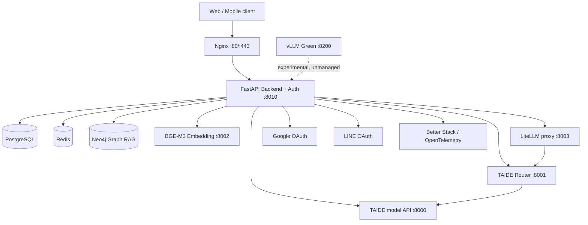

# BLINK production system architecture

Verified: **2026-09-25**

## Executive summary

BLINK is a modular monolith at the web/API layer with separate local AI model
processes. FastAPI on port 8010 owns both application API and authentication.
PostgreSQL is the durable application store, Redis supplies shared runtime state,
Neo4j supports Graph RAG, and model calls are served by managed local processes.



## Managed services

| Port | Service | Production role | Managed by runtime scripts |
|---:|---|---|:---:|
| 8000 | TAIDE model API | Chat/completion model; `TAIDE_BASE_URL` currently points here | Yes |
| 8001 | TAIDE Router | Routing layer; LiteLLM forwards `taide-12b` here | Yes |
| 8002 | BGE-M3 Embedding | Text-to-vector conversion for product/knowledge retrieval | Yes |
| 8003 | LiteLLM | OpenAI-compatible model proxy for `taide-12b` | Yes |
| 8010 | FastAPI Backend + Auth | Public application API, OAuth callbacks, chat and records | Yes |
| 8200 | vLLM Green | Capacity experiment only | **No — experimental** |

Ports 8004 and 8005 are retired. Port 8011 is not part of the current production
topology; authentication was merged into 8010.

## Primary request flows

### Authentication

```text
Client -> Nginx -> FastAPI :8010 -> Google/LINE OAuth
                              -> PostgreSQL identity repositories
                              -> Redis/session controls where configured
```

### Chat and knowledge retrieval

```text
Client -> FastAPI route
       -> request/auth/rate-limit guards
       -> conversation context
       -> knowledge/product/skin orchestration
       -> BGE-M3 :8002 for embeddings
       -> Neo4j / PostgreSQL retrieval
       -> TAIDE :8000 or managed router/proxy path
       -> persist conversation
       -> response/stream
```

### Readiness

`GET /readyz` on 8010 verifies application, PostgreSQL, Redis, TAIDE, TAIDE
Router, and Embedding dependencies. Nginx reachability and script/source hashes
are validated by `status-production.sh`.

## Source of truth

- Runtime scripts: `/var/lib/jenkins/tomod/ops/runtime/`
- Backend config: `/var/lib/jenkins/tomod/cosmetic-agent/.env`
- LiteLLM config: `/var/lib/jenkins/tomod/ops/runtime/litellm/config.yaml`
- ASGI target: `api.api_server:app`
- PostgreSQL migrations: `database/postgres/migrations/`

## Optional dependency boundary

- Zep and `psycopg` are loaded only when their features are used; importing the main API must not require optional integrations.
- Secrets must come from `cosmetic-agent/.env` or the process environment. Source-code fallback credentials are forbidden.
- The current repository regression baseline is `pytest -q`: 293 passed, 1 skipped, 10 subtests passed.

## Known limitations

- `api/api_server.py` is now 1,124 lines with no direct route decorators; it is the compatibility composition root for shared auth, security/admission wiring and router/service assembly. OAuth handlers live in `app/api/routes/oauth.py`.
- Service URL handling is scattered across agents/tools instead of clients.
- Repository modules exist in both `database/repositories/` and
  `database/postgres/repositories/`; do not delete either until imports migrate.
- `requirements-backend.txt` documents recently added production packages but is
  not yet a complete lock of the full running Python environment.
- The current production configuration explicitly names `taide-12b`; do not
  describe Terra as the active path without changing and verifying runtime config.
